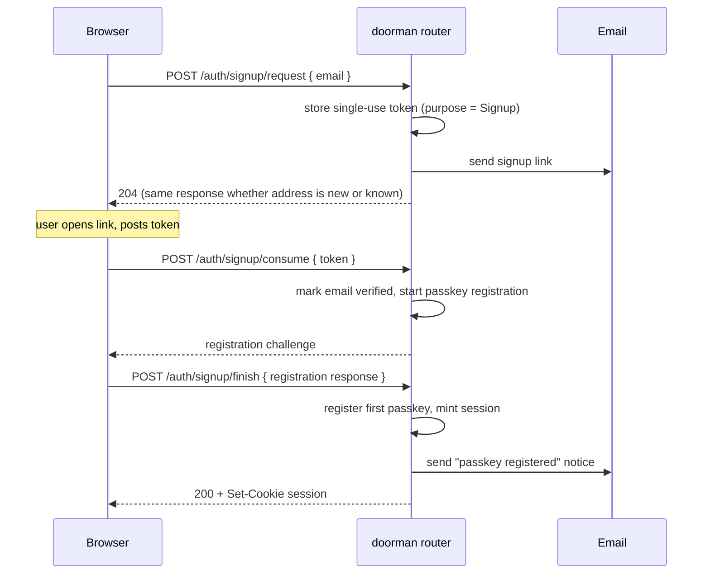
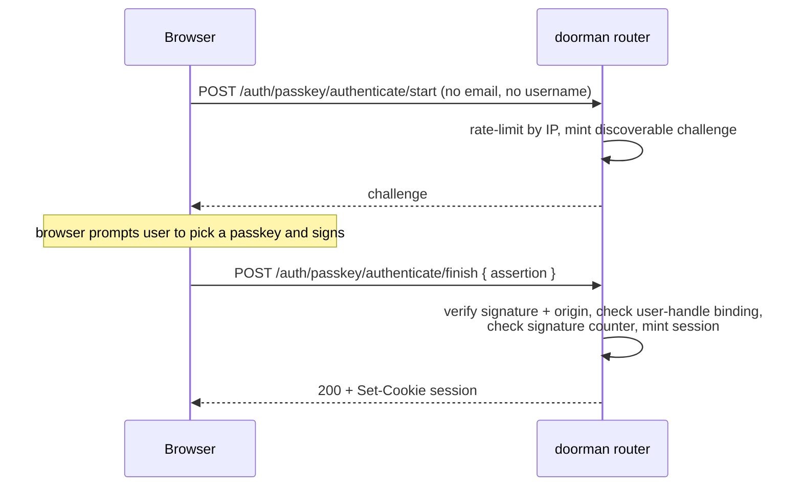
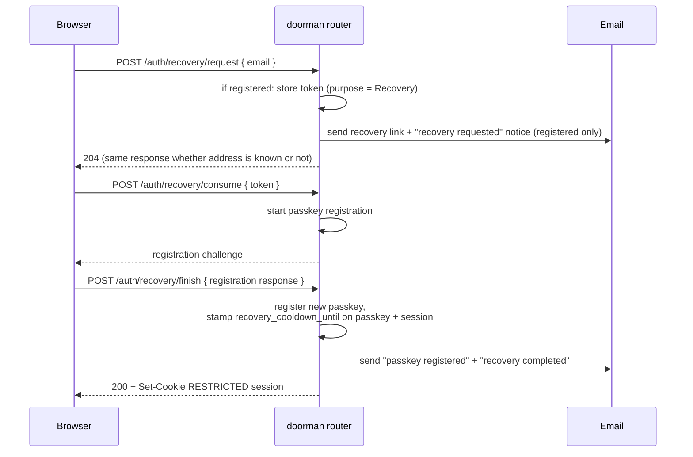

# Flows

The three first-class flows are **signup**, **login**, and **recovery**, plus the account-management operations. Each diagram shows the browser, the doorman router, and the email transport. Route paths are relative to the `/auth` prefix the router mounts under.

Read [concepts.md](concepts.md) first for the vocabulary (discoverable passkeys, opaque tokens, recovery cool-down).

## Signup

A new account is bootstrapped by proving control of an email address and then registering the first passkey. The session is issued only after the passkey is registered — the email link alone never logs anyone in.

`/auth/signup/request` returns the **same** response for a new and an already-registered address (an already-registered address simply gets no email), so the endpoint does not reveal who has an account.

## Login

Steady-state login is a single discoverable-passkey ceremony with no email and no username.

The server identifies the user from the authenticator-asserted **user handle** and verifies it matches the credential's stored owner before minting a session. The WebAuthn signature counter is checked for regression (cloned-authenticator detection). Every failure path emits an audit event. See [security.md](security.md#passkeys).

If the credential or session is still inside a recovery cool-down, the minted session is **restricted** (see below).

## Recovery

Recovery is for a user who lost every passkey. It deliberately requires enrolling a _new, visible_ passkey before any session is issued, and the resulting session is restricted by the cool-down.

Unknown addresses receive **no email** — sending one would be an enumeration oracle. The recovery-created passkey stores the same `recovery_cooldown_until` deadline as the session: signing in with it before the deadline mints another restricted session, and a passkey added from a restricted session inherits the deadline. Pre-existing passkeys and sessions stay unrestricted throughout.

## Restricted (cool-down) sessions

While a session is inside its recovery cool-down, the destructive lockout actions are blocked and everything else proceeds normally:

| Action                                                | During cool-down                 |
| ----------------------------------------------------- | -------------------------------- |
| Add a passkey                                         | Allowed (inherits the cool-down) |
| Rename a passkey (`PATCH /auth/passkey/{id}`)         | Allowed (cosmetic)               |
| Log out current session (`POST /auth/logout`)         | Allowed                          |
| Log out everywhere (`POST /auth/logout-all`)          | Allowed (own sessions only)      |
| Delete a passkey (`DELETE /auth/passkey/{id}`)        | **Blocked**                      |
| Revoke another session (`DELETE /auth/sessions/{id}`) | **Blocked**                      |
| Sign out everywhere _else_ (`DELETE /auth/sessions`)  | **Blocked**                      |

After the deadline passes, the checks treat the cool-down as inactive automatically; there is no cleanup job.

## Account management

Authenticated routes for an established account:

| Operation                | Route                                                      | Notes                                                              |
| ------------------------ | ---------------------------------------------------------- | ------------------------------------------------------------------ |
| List passkeys            | `GET /auth/passkey`                                        | Returns metadata (AAGUID, transports, backup state, device label). |
| Add passkey              | `POST /auth/passkey/register/start` → `/finish`            | Allowed during cool-down.                                          |
| Rename passkey           | `PATCH /auth/passkey/{credential_id}`                      | Ownership-checked; cosmetic, so allowed during cool-down.          |
| Delete passkey           | `DELETE /auth/passkey/{credential_id}`                     | Ownership-checked; blocked during cool-down.                       |
| List sessions            | `GET /auth/sessions`                                       | Carries IP / user-agent / device label.                            |
| Revoke one session       | `DELETE /auth/sessions/{id}`                               | Ownership-checked; blocked during cool-down for _other_ sessions.  |
| Sign out everywhere else | `DELETE /auth/sessions`                                    | Blocked during cool-down.                                          |
| Log out                  | `POST /auth/logout`                                        | Clears the cookie.                                                 |
| Log out everywhere       | `POST /auth/logout-all`                                    | Revokes all of the caller's sessions.                              |
| Change email             | `POST /auth/account/email` → `/auth/account/email/confirm` | Confirmation link to the new address; notice to the old one.       |
| Delete account           | `DELETE /auth/account`                                     | Cascades across all stores; blocked during cool-down.              |

Email change reuses the verification-token machinery: a single-use confirmation link goes to the **new** address and a security notice goes to the **old** one, and the change only lands when the new address confirms.

## Re-authentication for destructive actions

A host can require a **fresh passkey assertion immediately before** the destructive actions — delete account, request email change, remove passkey, revoke another session, sign out everywhere else — to prove the session is still operated by its owner (see [security.md](security.md#re-authentication-for-destructive-actions) for the threat model). The decision is **required**: wire `.reauthentication(ReauthPolicy::required_for([...]))` to gate actions, or `.reauthentication(ReauthPolicy::disabled())` to opt out. The build fails closed otherwise.

When an action is gated, the client follows one recipe for every protected route:

1. Call the destructive endpoint with no proof.
2. Server responds `401` with body `{ "error": { "code": "reauth_required", .. } }`.
3. `POST /auth/reauth/start` → `{ "challenge_id", "options" }`; run `navigator.credentials.get(options)` (the same call the sign-in page makes).
4. Re-call the destructive endpoint, now including `"reauthentication": { "challenge_id", "assertion" }` in the JSON body.

| Endpoint                                       | Body field carrying the proof |
| ---------------------------------------------- | ----------------------------- |
| `DELETE /auth/account`                         | `reauthentication`            |
| `POST /auth/account/email`                     | `reauthentication`            |
| `DELETE /auth/passkey/{credential_id}`         | `reauthentication`            |
| `DELETE /auth/sessions`                        | `reauthentication`            |
| `DELETE /auth/sessions/{id}` (another session) | `reauthentication`            |

The challenge is single-use, scoped to the session user's own credentials, and always requires user verification. `POST /auth/reauth/start` is authenticated and inherits the CSRF origin check like every mutation; it is **not** rate-limited (it is authenticated, sends no email, and guards an unforgeable signature). Non-interactive bearer clients cannot satisfy a re-auth gate — programmatic deletion is the operator surface's job.

## Security notifications

doorman sends best-effort security-notice emails (after the protected action has already succeeded) for: a registered-address recovery request, a completed recovery, every successful passkey registration, a passkey removal, an email-change request, revoking another session, and "sign out everywhere else". It does **not** send mail for unknown-address recovery, already-registered signup, or ordinary self-logout.
